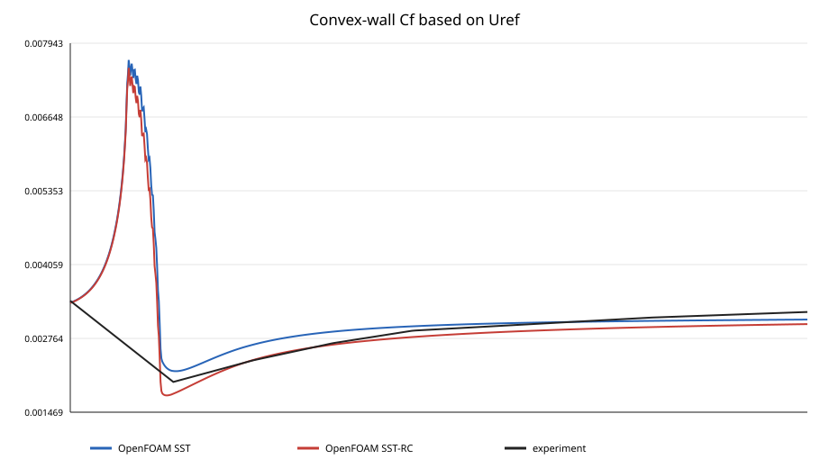
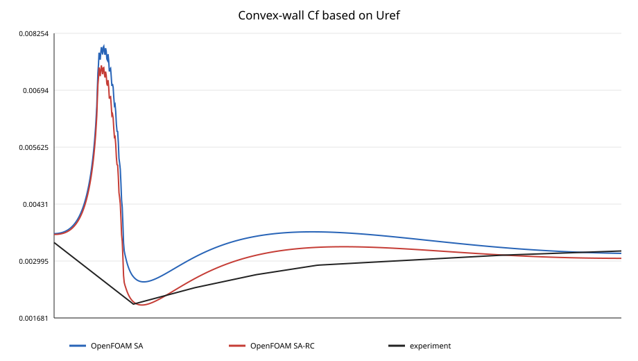
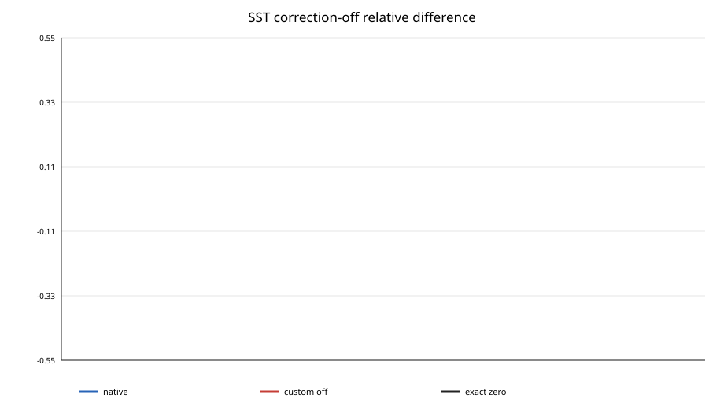
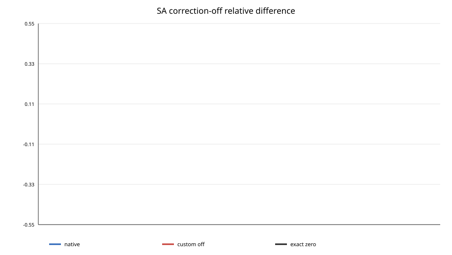
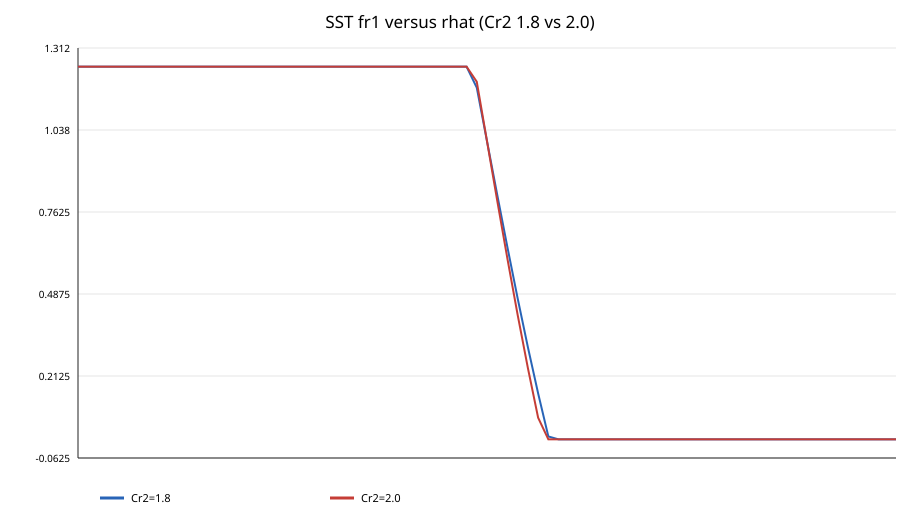
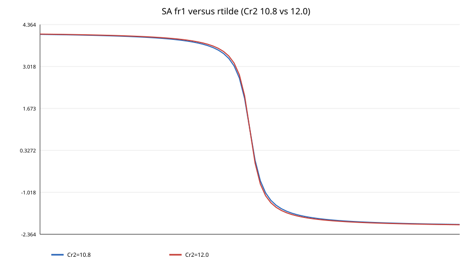

# SA-RC and SST-2003RC curvature-correction verification and validation

Generated from schema v1. Commit: `validation/curvature-correction based on 1961152`. 

## Executive summary

The implemented inertial-frame SA-RC and Smirnov-Menter correction algebra agrees with the published NASA TMR definitions, and deterministic tests plus native/correction-off CFD regression verify the implementation paths. On the converged three-grid Smits convex-curvature case both corrections produce the expected reduction in convex-wall Cf; profile differences contract with refinement. This is only one curvature family, however. No neutral benchmark, rotating-channel series, independent concave case, separated-flow benchmark, Reynolds/rotation-number sweep, or high-fidelity 3-D validation is available. The rotating-frame OmegaRot terms are not implemented. The correction is therefore not ready for an unrestricted model merge.

**Final recommendation: richiede modifiche e validazione aggiuntiva prima del merge definitivo**

## Implementation audit

Both models compute S, W, rStar and a material-derivative curvature invariant in common/curvatureFunctions.C. SST multiplies the parent raw production before native k/omega production limiters. SA modifies only Cb1 production from (1-ft2) to (fr1-ft2); destruction, Stilda and viscosity relations remain native. fr1 is AUTO_WRITE.

### Effective formulas

Common: S=sqrt(2 Sij Sij), W=sqrt(2 Wij Wij), r*=S/max(W,SMALL). SST: D2=max(S2,0.09 omega2), rhat=2 Wik Sjk DSij/Dt /(W D3), fr1=clip((1+Cr1) 2r*/(1+r*) [1-Cr3 atan(Cr2 rhat)]-Cr1,frMin,frMax). SA: D2=(S2+W2)/2, rtilde=2 Wik Sjk DSij/Dt /D4, with the same unbounded functional form. DS/Dt=symm(grad(ddt(U)))+div(phi,S)-S div(phi).

### Constants

| Model | Constant | Default | Units | Role |
| --- | --- | ---: | --- | --- |
| SST | `Cr1` | 1.0 | dimensionless | rotation-function offset/amplitude |
| SST | `Cr2` | 2.0 | dimensionless | curvature-indicator sensitivity |
| SST | `Cr3` | 1.0 | dimensionless | atan contribution amplitude |
| SST | `frMin` | 0.0 | dimensionless | lower production-factor clip |
| SST | `frMax` | 1.25 | dimensionless | upper production-factor clip |
| SA | `Cr1` | 1.0 | dimensionless | rotation-function offset/amplitude |
| SA | `Cr2` | 12.0 | dimensionless | curvature-indicator sensitivity |
| SA | `Cr3` | 1.0 | dimensionless | atan contribution amplitude |

### Code map

- `src/curvatureCorrectionModels/common/curvatureFunctions.C:14` — material derivative of strain
- `src/curvatureCorrectionModels/common/curvatureFunctions.C:32` — SST correction factor and clipping
- `src/curvatureCorrectionModels/common/curvatureFunctions.C:83` — unbounded SA correction factor
- `src/curvatureCorrectionModels/kOmegaSSTCC/kOmegaSSTCC.C:10` — SST raw-production override
- `src/curvatureCorrectionModels/SpalartAllmarasCC/SpalartAllmarasCC.C:98` — SA transport equation with corrected production
- `docs/implementation-audit.md` — complete derivation, parent comparison and asymptotic audit

### Numerical and modelling risks

- **high** — Published rotating-frame OmegaRot terms are absent, so MRF/rotating-frame equations are incomplete. Recommendation: Implement and test frame-rotation terms or enforce/document inertial-frame-only use.
- **high** — No neutral, rotating, independent concave, or separated-flow validation exists. Recommendation: Do not infer general model validity from Smits convex curvature.
- **medium** — Production C++ has no explicit finite-value guards for coefficients or invariants; NaN/Inf can propagate. Recommendation: Add fail-fast coefficient validation and runtime finite diagnostics.
- **medium** — SA fr1 is deliberately unbounded and reached about -3.24 to 9.17 on the fine Smits grid. Recommendation: Report production-weighted tails and stability across independent cases.
- **medium** — SST fr1 reaches both clipping bounds and pure strain activates the upper clip. Recommendation: Write a clipping mask and quantify volume- and production-weighted clipped fractions.
- **medium** — OpenFOAM v2412 kOmegaSST is SST-2003-like but documentation used unqualified SST-RC naming. Recommendation: Rename/document as SST-2003RC with the appropriate stress/production suffix.
- **low** — At S=W=0 the regularized factor is 0 for SST and -1 for SA, although raw production is zero. Recommendation: Judge neutrality on corrected production, not fr1 alone.

### Literature comparison

The SA function, D4 denominator, constants, unbounded factor, and placement on Cb1 production match NASA TMR SA-RC/Shur et al. The SST W D3 denominator, D2=max(S2,0.09 omega2), constants, [0,1.25] clipping and multiplication of both productions match NASA TMR SST-RC/Smirnov-Menter. Both published definitions include extra rotating-frame terms that are absent here. NASA TMR also recommends variant-specific naming when RC is added to SST-2003.

## Merge blockers

- The formulation is incomplete and unverified in rotating reference frames because the published OmegaRot terms are absent.
- No neutral CFD benchmark demonstrates that enabling the correction remains neutral when curvature and rotation effects are absent; correction-off recovery is exact but answers a different question.
- No independent validation benchmark outside the available Smits convex-curvature family has converged reference evidence.
- Production C++ lacks fail-fast checks for NaN, Inf and non-finite coefficients/intermediate fields.
- SST clipping has not been quantified by clipped volume, frequency, production weighting or spatial location.
- SA fr1 is unbounded, reached approximately 9.17 on the fine Smits grid, and has no application-specific upper-limit justification.
- Curvature/rotation indicator, base production, corrected production, production ratio and clipping-mask fields are not exported.
- The CI pipeline is prepared locally but has not been published or executed in GitHub because the PAT lacks workflow scope.

## Current validation status

- Verified for the principal algebraic and source-integration aspects in an inertial reference frame.
- Smits convex-wall results are promising and consistent with the expected stabilizing effect of convex curvature.
- Neutral behavior with the correction enabled is not demonstrated by a neutral CFD benchmark.
- Concave curvature, stabilizing/destabilizing rotation, rotating frames and separated curved flows remain unverified.
- Robustness across grids is demonstrated only for Smits Cf; scheme, y+, clipping and broader benchmark robustness remain unverified.
- No regression is observed when the correction is disabled, but regression with the correction enabled on neutral flows remains unverified.
## Verification

Twenty-five deterministic Python tests cover tensor invariants, material-derivative source contract, asymptotes, clipping, opposite curvature senses, coefficient/data validation, report metrics and report failure modes. The OpenFOAM library builds under v2412. Native and correction-off Cf agree exactly in the quick regression; full-field comparisons use relative L-infinity <= 1e-12. Serial restart and four-rank MPI restart are checked independently at 5e-4.

## Validation matrix

| Benchmark | Category | Models | Grid/cells | Reference | Converged | Grid-independent | Result |
| --- | --- | --- | --- | --- | --- | --- | --- |
| TMBWG 2DCC Smits convex wall - SST | convex curvature | OpenFOAM kOmegaSST vs kOmegaSSTCC | 129x49 / 257x97 / 513x193 / 6,144 / 24,576 / 98,304 | Smits, Young & Bradshaw experiment; TMBWG corrected data | True | True | improves |
| TMBWG 2DCC Smits convex wall - SA | convex curvature | OpenFOAM SpalartAllmaras vs SpalartAllmarasCC | 129x49 / 257x97 / 513x193 / 6,144 / 24,576 / 98,304 | Smits, Young & Bradshaw experiment; TMBWG corrected data | True | True | improves |
| Native versus custom correction-off regression | regression | SST/native-off and SA/native-off | 129x49 / 6144 | native OpenFOAM parent fields | True | None | neutral |
| Finite-span flap visible tip vortex | qualitative 3-D application | kOmegaSST vs kOmegaSSTCC | single snappyHexMesh / 584052 | none | False | False | non-conclusive |
| Algebraic Cr2 sensitivity | local sensitivity | SST-RC and SA-RC scalar functions | not applicable / not applicable | none | True | None | non-conclusive |

## Quantitative results

### TMBWG 2DCC Smits convex wall - SST

Convex curvature should stabilize turbulence and lower wall shear. SST-RC reduces bend Cf by 18.46%, 19.83%, and 22.41% from coarse to fine. The profile comparison below is fine-grid only and uses experimental-overlap points; classification accounts for the available reference but not experimental uncertainty because pointwise uncertainty was not supplied.

#### Convex-wall Cf based on Uref — improves



| Variant | RMSE | nRMSE | MAE | Bias | Max abs | Mean rel. | Max rel. |
| --- | ---: | ---: | ---: | ---: | ---: | ---: | ---: |
| baseline | 0.000958013 | 0.334734 | 0.000361528 | 0.000315093 | 0.00503236 | 0.330328 | 1.95416 |
| corrected | 0.000886125 | 0.309616 | 0.000339438 | 0.000137428 | 0.00489432 | 0.239263 | 1.87072 |

Weights: trapezoidal x-spacing weights on the experimental overlap.

### TMBWG 2DCC Smits convex wall - SA

SA-RC reduces bend Cf by 18.83%, 19.49%, and 22.02% from coarse to fine, the expected stabilizing trend. SA-RC has the slowest observed profile-convergence order and the widest fr1 range; these limit confidence in small local differences.

#### Convex-wall Cf based on Uref — improves



| Variant | RMSE | nRMSE | MAE | Bias | Max abs | Mean rel. | Max rel. |
| --- | ---: | ---: | ---: | ---: | ---: | ---: | ---: |
| baseline | 0.00118564 | 0.414268 | 0.000721828 | 0.000717844 | 0.00542417 | 0.487076 | 2.16757 |
| corrected | 0.000971198 | 0.339341 | 0.000457712 | 0.000411502 | 0.00493914 | 0.335969 | 1.94992 |

Weights: trapezoidal x-spacing weights on the experimental overlap.

### Native versus custom correction-off regression

The quick case recovers native Cf exactly with correction disabled. Dedicated field comparisons enforce relative L-infinity <=1e-12 for U, p, turbulence working variables, and nut.

#### SST correction-off relative difference — neutral



| Variant | RMSE | nRMSE | MAE | Bias | Max abs | Mean rel. | Max rel. |
| --- | ---: | ---: | ---: | ---: | ---: | ---: | ---: |
| baseline | 0 | 0 | 0 | 0 | 0 | n/a | n/a |
| corrected | 0 | 0 | 0 | 0 | 0 | n/a | n/a |

Weights: uniform point weights.

#### SA correction-off relative difference — neutral



| Variant | RMSE | nRMSE | MAE | Bias | Max abs | Mean rel. | Max rel. |
| --- | ---: | ---: | ---: | ---: | ---: | ---: | ---: |
| baseline | 0 | 0 | 0 | 0 | 0 | n/a | n/a |
| corrected | 0 | 0 | 0 | 0 | 0 | n/a | n/a |

Weights: uniform point weights.

### Finite-span flap visible tip vortex

This 100-iteration smoke run verifies that Q.vtp and .foam markers expose a visible rolled-up vortex. It is not converged and has no experimental/DNS reference; the approximately 21% greater Q and 9.8% greater axial vorticity at x/c=6 are sensitivity evidence only.

#### Mean tip-core peak Q [1/s2] — non-conclusive

![Mean tip-core peak Q [1/s2]](plots/flap-tip-vortex-q-peak.svg)

| Variant | RMSE | nRMSE | MAE | Bias | Max abs | Mean rel. | Max rel. |
| --- | ---: | ---: | ---: | ---: | ---: | ---: | ---: |
| baseline | n/a | n/a | n/a | n/a | n/a | n/a | n/a |
| corrected | n/a | n/a | n/a | n/a | n/a | n/a | n/a |

Weights: uniform point weights.

#### Mean tip-core peak abs(omega_x) [1/s] — non-conclusive

![Mean tip-core peak abs(omega_x) [1/s]](plots/flap-tip-vortex-vorticity-peak.svg)

| Variant | RMSE | nRMSE | MAE | Bias | Max abs | Mean rel. | Max rel. |
| --- | ---: | ---: | ---: | ---: | ---: | ---: | ---: |
| baseline | n/a | n/a | n/a | n/a | n/a | n/a | n/a |
| corrected | n/a | n/a | n/a | n/a | n/a | n/a | n/a |

Weights: uniform point weights.

### Algebraic Cr2 sensitivity

The default Cr2 response is compared with -10% Cr2 over indicator [-2,2] at rStar=1. This verifies a smooth trend away from clip breakpoints and visualizes SST plateaus. It is not a CFD calibration or robustness result.

#### SST fr1 versus rhat (Cr2 1.8 vs 2.0) — non-conclusive



| Variant | RMSE | nRMSE | MAE | Bias | Max abs | Mean rel. | Max rel. |
| --- | ---: | ---: | ---: | ---: | ---: | ---: | ---: |
| baseline | n/a | n/a | n/a | n/a | n/a | n/a | n/a |
| corrected | n/a | n/a | n/a | n/a | n/a | n/a | n/a |

Weights: uniform point weights.

#### SA fr1 versus rtilde (Cr2 10.8 vs 12.0) — non-conclusive



| Variant | RMSE | nRMSE | MAE | Bias | Max abs | Mean rel. | Max rel. |
| --- | ---: | ---: | ---: | ---: | ---: | ---: | ---: |
| baseline | n/a | n/a | n/a | n/a | n/a | n/a | n/a |
| corrected | n/a | n/a | n/a | n/a | n/a | n/a | n/a |

Weights: uniform point weights.

## Grid convergence

All 12 Smits runs converged. From 129x49 to 257x97 and then 513x193, relative profile-RMS differences contracted for SST (0.04106 to 0.02121), SST-RC (0.03889 to 0.02067), SA (0.01253 to 0.007397), and SA-RC (0.01387 to 0.01007). Approximate observed orders are 0.953, 0.912, 0.760, and 0.462; corresponding fine-grid GCI estimates are 2.83%, 2.93%, 1.33%, and 3.33%. The corrected response remains grid-sensitive: bend Cf reduction grows from 18.46% to 22.41% for SST and from 18.83% to 22.02% for SA. Improvements comparable to these GCI values must not be overinterpreted.

## Sensitivity and robustness

Only an algebraic +/-10% Cr2 sweep is included; it demonstrates smooth indicator trends and the SST clipping plateaus, not physical robustness. Reynolds number, rotation number, delta/Rc, radius, all correction constants, clipping limits, y+, schemes, and mesh-quality sensitivities remain untested. On the fine grid, corrected/base execution-time ratios were 1.569 for SST and 1.150 for SA, including different convergence iteration counts (1989 vs 1871 and 1962 vs 2080).

## Acceptance criteria

| Criterion | Critical | Status | Evidence |
| --- | --- | --- | --- |
| All critical deterministic unit tests pass | True | pass | 25/25 Python tests passed; 18 directly cover kinematics/source contract |
| No NaN or Inf in executed tests | True | pass | oracle rejects non-finite input; grid analyser scanned 12 solver logs and all extracted fields were finite |
| Correction-off exactly recovers parent | True | pass | quick Cf relative error 0; field tolerance 1e-12 |
| No significant regression on neutral CFD benchmarks | True | not-verified | no flat plate, non-rotating channel or attached neutral airfoil run |
| Improves more than one independent rotation/curvature benchmark | True | not-verified | only Smits convex curvature has converged reference data; flap is unconverged and reference-free |
| Correct trend across multiple rotation/curvature parameters | True | not-verified | single physical radius/condition; algebraic sweep is not physical validation |
| Improvement exists on sufficiently converged grids | True | pass | all Smits profiles contract; fine relative differences <=2.12%; GCI reported |
| Clipping is not dominant | True | not-verified | SST reaches both bounds; volume/production-weighted clipping fraction is not written |
| Computational cost is documented | False | pass | fine corrected/base execution ratios: SST 1.569, SA 1.150 |
| Model and evidence limitations are explicit | False | pass | audit and report list frame, Boussinesq, benchmark, diagnostic and uncertainty limits |
| Results are reproducible from repository files | True | pass | versioned resources/hashes, runners, collector, schema, generator, tests and CI are included |

## Missing or non-conclusive work

- Flat-plate ZPG, non-rotating channel, and attached-boundary-layer neutral regressions were not available in the repository.
- Rotating plane channel at three rotation numbers was not run because published rotating-frame terms are not implemented and no case/reference data are present.
- Independent convex and concave boundary-layer cases were not available; Smits concave-side 2-D results are not a definitive discriminator because Gortler structures are three-dimensional.
- U-bend/S-bend/curved diffuser with pressure loss and secondary-flow reference data was not available.
- Periodic hills, curved backward-facing step, or another separation benchmark was not available.
- No coarse/medium/fine industrial 3-D benchmark with DNS/LES/experiment was available.
- No Reynolds-number, rotation-number, delta/Rc, radius, y+, numerical-scheme, or full coefficient/clipping sweep was executed.
- No manufactured solution for the discretized material derivative was implemented.
- Cp, velocity/k/omega/nuTilda profiles, Reynolds stresses, production/destruction maps, separation and reattachment metrics were not available for the retained benchmark evidence.
- Non-converged cases: flap-tip-vortex
- Datasets without reference: flap-tip-vortex/q-peak, flap-tip-vortex/vorticity-peak, cr2-sensitivity/sst, cr2-sensitivity/sa

## Known issues and limitations

- The explicit OmegaRot additions in W and DS/Dt are absent; use in MRF/rotating frames is outside validated scope.
- Linear eddy-viscosity/Boussinesq models cannot generally represent curvature-driven anisotropy and secondary stresses like a Reynolds-stress model.
- Smits OpenFOAM calculations are incompressible while the retained TMBWG computations are essentially incompressible compressible solutions at Mach 0.093.
- All nested Smits meshes intentionally fail one check for very high boundary-layer-cell aspect ratio; topology, skewness and non-orthogonality pass.
- Formal uncertainty on sparse experimental Cf points is unavailable, so metric classification does not include experimental error bars.
- The approximate GCI uses norms of successive profile differences; it is not a pointwise Richardson extrapolation and the observed orders are below the nominal scheme order.
- Tip-vortex results are stopped at 100 iterations and must not be used quantitatively.
- Memory was not instrumented. Fine-grid execution-time ratios are available, but isolated per-iteration correction overhead is not quantified.
- Systematic grid independence exists only for Smits Cf; numerical-scheme independence and grid studies across the remaining validation matrix are absent.
- A local improvement may partly compensate numerical or model-form error; no independent dataset currently separates that possibility.

## Conditions before definitive merge

1. Do not modify native SA or SST behavior; if integrated experimentally, make the correction explicitly disabled by default.
2. Add fail-fast production checks for NaN, Inf and non-finite correction inputs/intermediates.
3. Export the curvature/rotation indicator, base and corrected production, production ratio and clipping mask.
4. Complete at least one neutral benchmark, one physically appropriate concave benchmark and one rotating benchmark.
5. Quantify clipping extent, frequency, location and production weighting, and justify the unbounded SA response.
6. Publish and successfully execute the prepared CI pipeline.

## Reproduction

```bash
source /home/mttbrbr/OpenFOAM/OpenFOAM-v2412/etc/bashrc
wmake libso src/curvatureCorrectionModels
```

```bash
python3 -m unittest discover -s tests -v
```

```bash
cd tutorials/incompressible/simpleFoam/smitsCurve
CURVATURE_SKIP_BUILD=1 ./Allrun
CURVATURE_SKIP_BUILD=1 ./Allrun-restartMPI
CURVATURE_SKIP_BUILD=1 ./Allrun-gridStudy
```

```bash
python3 tools/collect_curvature_validation_data.py
python3 tools/generate_curvature_validation_report.py data/curvature-validation/validation-input.json --output-dir reports/curvature-validation
```

```bash
cd tutorials/incompressible/simpleFoam/flapTipVortex
./Allrun
# generates runs/SST/SST.foam, runs/SSTCC/SSTCC.foam and postProcessing/Qsurface/<time>/Q.vtp
```

## Conclusion

SA-RC and SST correction formulas are verified for the principal implementation aspects in an inertial frame and show the expected stabilizing trend on a grid-refined convex-curvature benchmark. The evidence does not establish neutral CFD behavior, concave/rotating-frame response, or general predictive improvement. The change may remain experimental, or be integrated only behind an option explicitly disabled by default, while the listed conditions are completed. Final recommendation: richiede modifiche e validazione aggiuntiva prima del merge definitivo.

